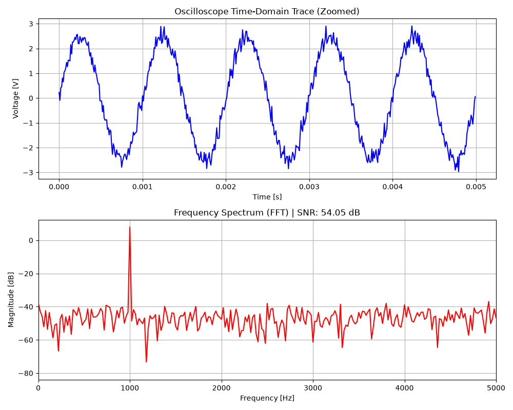
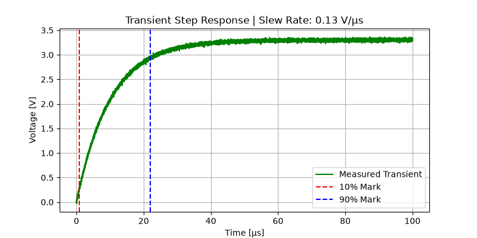

# Automated Mixed-Signal Characterization & Validation Suite

An automated Python-based post-silicon validation suite designed to ingest time-domain oscilloscope traces and programmatically extract critical AC and Transient datasheet parameters for amplifiers and mixed-signal ICs.

## Key Features
- **Data Ingestion:** Parses raw continuous voltage traces from digital oscilloscope exports (CSV format).
- **AC / Frequency Domain Analysis:** Utilizes SciPy `fft` algorithms to transform time-domain waveforms into frequency spectra, automating the extraction of:
  - **SNR** (Signal-to-Noise Ratio)
  - **THD** (Total Harmonic Distortion)
  - **SFDR** (Spurious-Free Dynamic Range)
- **Transient / Time Domain Analysis:** Algorithmically evaluates RC step responses to calculate physical hardware constraints in the presence of noise:
  - **10-90% Rise Time**
  - **Slew Rate** (V/µs)
- **Automated Validation Reports:** Exports dynamically annotated diagnostic plots for immediate bench verification without manual cursor measurements.

## Diagnostic Outputs

### 1. AC Characterization (FFT Spectrum & SNR/THD)


### 2. Transient Step Response (Slew Rate & Rise Time)


## Repository Structure
```text
ValiBench/
├── data/
│   └── raw_oscilloscope_trace.csv      # Simulated oscilloscope export
├── scripts/
│   ├── generate_data.py                # Generates bench test vectors + thermal noise
│   ├── characterize_amplifier.py       # DSP engine for FFT, SNR, THD, and SFDR
│   └── characterize_transient.py       # Time-domain engine for Slew Rate and Rise Time
├── outputs/                            # Auto-generated diagnostic plots
└── README.md
```

## Tech Stack

- **Language:** Python
- **Data Processing:** NumPy, Pandas
- **Signal Processing:** SciPy FFT
- **Visualization:** Matplotlib

## Running the Project

Install the required dependencies:

```bash
pip install numpy pandas matplotlib scipy
```

Generate the sample oscilloscope data:

```bash
python scripts/generate_data.py
```

Run the AC characterization:

```bash
python scripts/characterize_amplifier.py
```

Run the transient response analysis:

```bash
python scripts/characterize_transient.py
```

The diagnostic plots are saved in the `outputs/` directory.

---